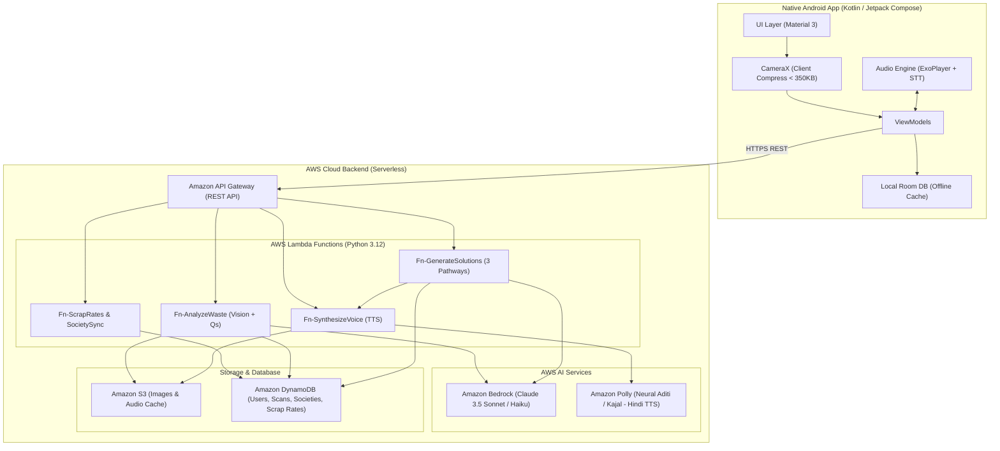

# System Architecture Document (ARCHITECTURE.md)

**Project Codename:** *EcoSnap Bharat* (Temporary Name)  
**Target Platform:** Native Android (Kotlin / Jetpack Compose) + AWS Serverless Cloud  
**Compliance:** AWS Open Source Tools (AWS SAM CLI / LocalStack) & AWS Free Tier Cloud Services  

---

## 1. High-Level Architecture Overview

The system follows an event-driven serverless architecture designed for sub-2-second latency, zero idle server cost, and seamless offline degradation for low-connectivity regions across India.



---

## 2. Native Android Client Architecture

The mobile application is built natively for Android using modern Android development practices (MAD):

### 2.1 Technology Stack
* **Language:** Kotlin 2.0+
* **UI Toolkit:** Jetpack Compose with Material Design 3
* **Camera Pipeline:** AndroidX CameraX (with client-side image compression to WebP/JPEG $\le 350\text{ KB}$)
* **Networking:** Retrofit 2 + OkHttp 4 (with exponential backoff and network status interceptors)
* **Local Persistence:** Room SQLite (caching offline scrap prices, 30+ default upcycling recipes, and scan history)
* **Audio Playback:** Media3 / ExoPlayer (streaming MP3 synthesized from Amazon Polly)
* **Voice Input:** Android `SpeechRecognizer` (supports offline Devanagari Hindi `hi-IN` and English `en-IN` recognition)
* **Dependency Injection:** Dagger Hilt

### 2.2 Client Layer Architecture (Clean Architecture / MVVM)
```
com.ecosnap.bharat
├── data
│   ├── local (Room DB: ScanDao, RecipeDao, ScrapRateDao)
│   ├── remote (ApiService, AwsS3Uploader, RetrofitInstance)
│   └── repository (WasteRepositoryImpl, ScrapRateRepositoryImpl)
├── domain
│   ├── model (WasteItem, SolutionBundle, ScrapPrice, SocietyMetrics)
│   └── usecase (AnalyzeWasteUseCase, GenerateSolutionsUseCase, PlayVoiceUseCase)
├── presentation
│   ├── home (HomeScreen, HomeViewModel)
│   ├── camera (CameraScreen, CameraViewModel)
│   ├── solutions (SolutionCardsScreen, SolutionViewModel)
│   ├── scrap (ScrapRateScreen, ScrapRateViewModel)
│   ├── society (SocietyScreen, SocietyViewModel)
│   └── theme (Color, Type, Theme)
└── utils (AudioPlayerManager, ImageCompressor, NetworkMonitor)
```

---

## 3. AWS Serverless Backend Services

### 3.1 REST API Endpoints (Amazon API Gateway)

| Endpoint | Method | Lambda Handler | Description |
| :--- | :--- | :--- | :--- |
| `/api/v1/waste/presigned-url` | `POST` | `Fn-AnalyzeWaste` | Generates pre-signed S3 PUT URL for direct client upload |
| `/api/v1/waste/analyze` | `POST` | `Fn-AnalyzeWaste` | Invokes Bedrock Multimodal Vision; returns item tag & 2 situational questions |
| `/api/v1/waste/solutions` | `POST` | `Fn-GenerateSolutions` | Takes user answers; generates 3 pathways and returns text + Polly audio URL |
| `/api/v1/scrap-rates` | `GET` | `Fn-ScrapRates` | Returns current market scrap rates (₹/kg) |
| `/api/v1/society/sync` | `POST` | `Fn-SocietySync` | Atomically updates community compost and landfill diversion counters |

---

## 4. AI & Multimodal Prompt Engineering Pipeline

### 4.1 Step 1: Multimodal Vision & Diagnostic Analysis
* **Model:** `anthropic.claude-3-5-sonnet-20241022-v2:0` (or `anthropic.claude-3-haiku-20240307-v1:0` via Amazon Bedrock)
* **Input:** Base64 / S3 URI of compressed user photo + user language preference (`hi` / `hinglish` / `en`).

#### Vision System Prompt:
```text
You are an expert Indian waste auditor and vernacular recycling companion for everyday households and villages.
Your task is to identify the waste item in the photo and formulate 2 ultra-simple situational questions to determine how the user can repurpose it at home.

Return strictly valid JSON following this schema:
{
  "item_name_hindi": "1-लीटर प्लास्टिक की पानी की बोतल",
  "item_name_english": "1-Litre Plastic Water Bottle",
  "material_category": "PET Plastic (Code 1)",
  "cleanliness_condition": "clean | soiled | hazardous",
  "diagnostic_questions": [
    {
      "question_id": "q1",
      "question_hindi": "क्या आपके घर में पौधे या गमले हैं?",
      "question_english": "Do you have potted plants or a garden?",
      "options": [
        {"id": "opt1", "label_hindi": "हाँ, गमले हैं", "label_english": "Yes, have plants"},
        {"id": "opt2", "label_hindi": "नहीं, पौधे नहीं हैं", "label_english": "No plants"}
      ]
    },
    {
      "question_id": "q2",
      "question_hindi": "क्या आपके पास कैंची या चाकू है?",
      "question_english": "Do you have scissors or a cutter?",
      "options": [
        {"id": "opt3", "label_hindi": "हाँ, कैंची है", "label_english": "Yes"},
        {"id": "opt4", "label_hindi": "कुछ नहीं है", "label_english": "No tools"}
      ]
    }
  ]
}
```

---

### 4.2 Step 2: 3-Pathway Vernacular Solution Generator
* **Input:** Identified item + user's selected answers to the 2 diagnostic questions.

#### Solution Generation Prompt:
```text
Generate exactly 3 actionable, localized Indian solutions for this waste item based on the user's situation:
1. "Ghar Ka Jugaad" (Home DIY Upcycle): Step-by-step zero-cost household reuse in under 5 minutes.
2. "Urja Aur Khad" (Home Energy & Soil Resource): Micro-energy (SODIS water purification, bio-enzymes, compost acceleration, fire briquettes, used oil soap/fuel).
3. "Kabaad Se Kamai" (Scrap Value & Safe Disposal): Fair market scrap rate in ₹/kg, prep instructions (flattening, cleaning), and bin classification (Wet/Dry/Hazardous).

Language requirement: Use simple, culturally natural Hindi/Hinglish (e.g. use terms like 'जुगाड़', 'खाद', 'रद्दी', 'कबाड़ी').

Return strictly valid JSON:
{
  "jugaad": {
    "title_hindi": "खुद पानी पीने वाला गमला",
    "title_english": "Self-Watering Planter",
    "time_minutes": 5,
    "cost_inr": 0,
    "steps_hindi": [
      "बोतल को बीच से कैंची से दो टुकड़ों में काटें।",
      "ऊपरी हिस्से को उल्टा करके नीचे वाले हिस्से में रखें।",
      "ढक्कन में छेद करके सूती डोरी डालें और मिट्टी भरें।"
    ],
    "polly_speech_script_hindi": "उपाय एक: घर का जुगाड़। आप इस बोतल से खुद पानी पीने वाला गमला बना सकते हैं। बोतल को बीच से काटें, ऊपरी हिस्से को उल्टा करके नीचे रखें और सूती डोरी डालकर मिट्टी भरें।"
  },
  "energy_resource": {
    "title_hindi": "SODIS: धूप से पानी शुद्ध करें",
    "title_english": "SODIS: Solar Water Disinfection",
    "method_hindi": "बोतल में नल का पानी भरें और 6 घंटे के लिए सीधी धूप में छत पर रखें। सूरज की किरणें पानी के बैक्टीरिया को खत्म कर देंगी।",
    "energy_type": "Solar UV-A Thermal Recovery",
    "polly_speech_script_hindi": "उपाय दो: सौर ऊर्जा से पानी की शुद्धि। बोतल को धूप में 6 घंटे रखकर पीने का पानी सुरक्षित करें।"
  },
  "scrap_disposal": {
    "bin_type": "Dry Waste (नीला डस्टबिन)",
    "market_scrap_rate_inr_per_kg": "₹10 - ₹12",
    "preparation_tip_hindi": "बोतल को पिचकाकर ढक्कन कस दें ताकि कबाड़ी के बोरे में कम जगह लगे।",
    "polly_speech_script_hindi": "उपाय तीन: कबाड़ से कमाई। इसे नीले डस्टबिन में डालें। इसका कबाड़ी भाव दस से बारह रुपये प्रति किलो है।"
  },
  "impact": {
    "weight_grams": 40,
    "co2_prevented_kg": 0.08
  }
}
```

---

## 5. Amazon Polly Speech Pipeline (Hindi Voice Synthesis)

1. **Service Configuration:**
   * **Engine:** `neural`
   * **Voice ID:** `Aditi` (Native Hindi & Indian English bilingual neural voice)
   * **Output Format:** `mp3` (bitrate 24 kbps for low bandwidth)
2. **Speech Synthesis Architecture:**
   * Lambda synthesizes the audio buffer using `boto3.client('polly').synthesize_speech()`.
   * The audio stream is saved directly into `s3://ecosnap-audio-cache/{scan_id}_{step}.mp3`.
   * A short-lived CloudFront / pre-signed S3 URL is returned to the Android app.
   * Android client streams the audio instantly via `ExoPlayer` while highlighting the active step text in real-time.

---

## 6. Amazon DynamoDB Database Schema

### 6.1 Table 1: `EcoSnap-Users`
* **Partition Key (PK):** `user_id` (String - UUID)
* **Attributes:**
  * `name`: String
  * `phone`: String (Optional)
  * `mode`: String (`FAMILY` | `SOCIETY`)
  * `language`: String (`hi` | `hinglish` | `en`)
  * `society_id`: String (Foreign key to `EcoSnap-Societies`)
  * `total_diverted_kg`: Number (Atomic counter)
  * `total_saved_inr`: Number (Atomic counter)
  * `created_at`: String (ISO-8601)

### 6.2 Table 2: `EcoSnap-Scans`
* **Partition Key (PK):** `user_id` (String)
* **Sort Key (SK):** `scan_id` (String: `SCAN#timestamp#uuid`)
* **Attributes:**
  * `item_name`: String
  * `material_category`: String
  * `image_s3_key`: String
  * `user_answers`: Map (`{"q1": "opt1", "q2": "opt3"}`)
  * `solutions_payload`: Map (Complete JSON response)
  * `audio_s3_url`: String
  * `logged_to_society`: Boolean
  * `timestamp`: Number (Unix epoch)

### 6.3 Table 3: `EcoSnap-Societies`
* **Partition Key (PK):** `society_id` (String: `SOC#pincode#id`)
* **Attributes:**
  * `name`: String (e.g., "Gokuldham RWA, Block-B")
  * `pincode`: String
  * `total_waste_diverted_kg`: Number (Global atomic counter)
  * `community_compost_kg`: Number
  * `total_scrap_revenue_inr`: Number
  * `next_bulk_pickup`: String (ISO date)
  * `member_count`: Number

### 6.4 Table 4: `EcoSnap-ScrapRates`
* **Partition Key (PK):** `region_code` (String: `DEFAULT` or `DELHI_NCR`)
* **Sort Key (SK):** `material_id` (String: `MAT_PLASTIC_PET`, `MAT_IRON`, etc.)
* **Attributes:**
  * `name_hindi`: String ("प्लास्टिक बोतल")
  * `name_english`: String ("PET Bottles")
  * `min_price_inr`: Number
  * `max_price_inr`: Number
  * `unit`: String ("per kg")
  * `updated_at`: String

---

## 7. Local Development & Hackathon Tooling

To satisfy the hackathon’s **"Build It"** track requirement (*using AWS Open Source tools locally without incurring cloud charges*):

### 7.1 AWS SAM CLI (`template.yaml`)
A single `template.yaml` defines the serverless application:
```yaml
AWSTemplateFormatVersion: '2010-09-09'
Transform: AWS::Serverless-2016-10-31
Description: EcoSnap Bharat - Serverless Backend for Waste-to-Energy Mobile App

Globals:
  Function:
    Timeout: 30
    MemorySize: 512
    Runtime: python3.12

Resources:
  AnalyzeWasteFunction:
    Type: AWS::Serverless::Function
    Properties:
      CodeUri: backend/lambdas/analyze_waste/
      Handler: app.lambda_handler
      Policies:
        - S3CrudPolicy:
            BucketName: !Ref WasteBucket
        - AmazonBedrockFullAccess
      Events:
        AnalyzeApi:
          Type: Api
          Properties:
            Path: /api/v1/waste/analyze
            Method: post

  GenerateSolutionsFunction:
    Type: AWS::Serverless::Function
    Properties:
      CodeUri: backend/lambdas/generate_solutions/
      Handler: app.lambda_handler
      Policies:
        - AmazonBedrockFullAccess
        - AmazonPollyReadOnlyAccess
        - S3CrudPolicy:
            BucketName: !Ref AudioBucket
      Events:
        SolutionsApi:
          Type: Api
          Properties:
            Path: /api/v1/waste/solutions
            Method: post

  WasteBucket:
    Type: AWS::S3::Bucket

  AudioBucket:
    Type: AWS::S3::Bucket
```

### 7.2 LocalStack Integration
* Developers can spin up a complete mock AWS cloud locally using Docker:
  ```bash
  localstack start -d
  sam local start-api --docker-network host
  ```
* DynamoDB and S3 can be emulated locally for free offline testing before deployment to AWS Free Tier.

---

## 8. Latency, Cost & Performance Benchmarks

| Metric | Target | Optimization Strategy |
| :--- | :--- | :--- |
| **Image Upload Time** | $< 800\text{ ms}$ on 4G | Native CameraX compression to $800 \times 600$ WebP ($< 250\text{ KB}$) |
| **Bedrock Vision Tagging** | $< 1.2\text{ s}$ | Direct S3 byte streaming into Claude 3.5 Haiku/Sonnet endpoint |
| **Polly Audio Generation** | $< 600\text{ ms}$ | Low-bitrate neural MP3 (24kbps); cached in S3 by text hash |
| **AWS Operating Cost** | ₹0.00 / Free Tier | S3 lifecycle rule auto-purges raw images after 7 days; DynamoDB On-Demand Free Tier handles 25 RCU/WCU |
